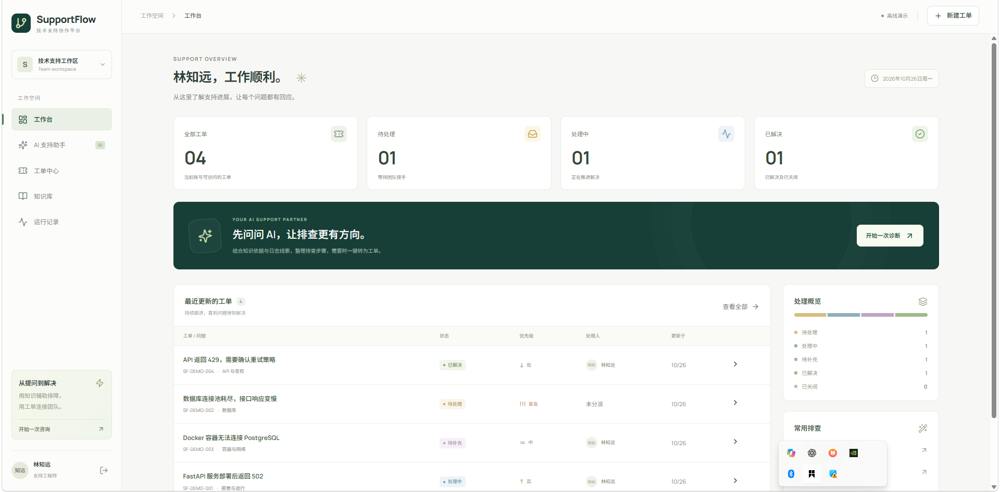
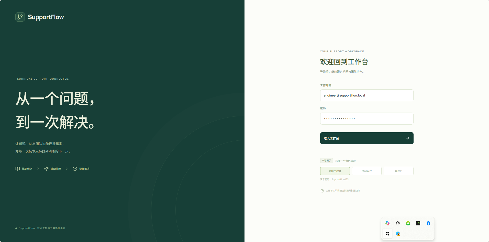
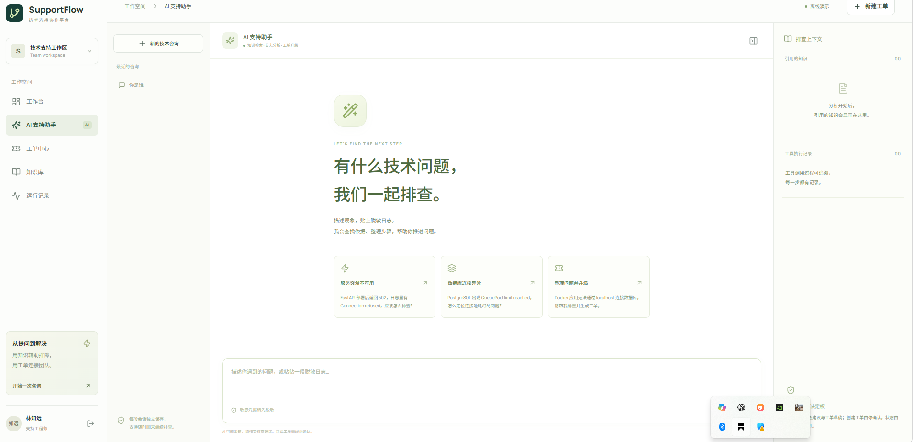
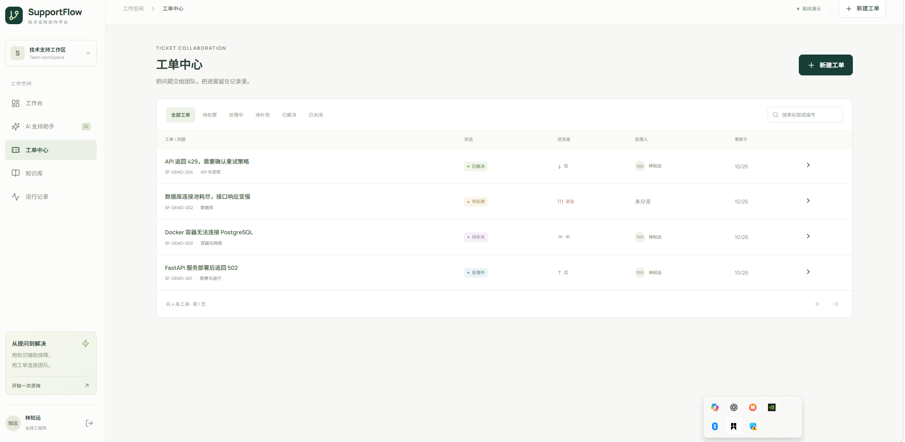
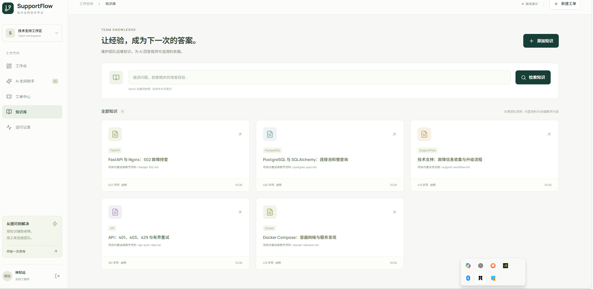
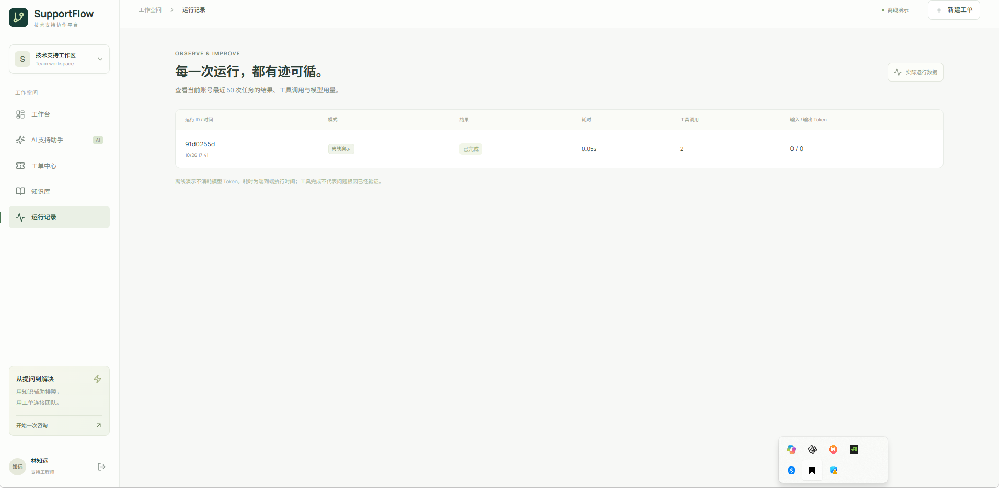

# SupportFlow · 技术支持与工单协作平台

参考 DeerFlow 的技术架构实现的独立全栈项目。用户描述故障后，Agent 检索知识、分析日志并提出排查建议；需要升级时先形成草稿，由用户确认后正式创建工单，支持工程师继续分派、讨论与跟进。

**技术栈：React 19 / TypeScript / Vite · Tailwind CSS / shadcn/ui · FastAPI / Pydantic · LangGraph · PostgreSQL / SQLAlchemy / Alembic · rank-bm25 · SSE · Docker Compose。**

本地开发默认 SQLite；Compose 使用 PostgreSQL。Chroma + 独立 Embedding 服务为可选能力，默认关键词检索无需下载模型。

## 界面演示

以下为离线演示模式下的早期界面截图；当前版本增加了知识来源、产品 / 版本筛选和实时文本输出。

**工作台**：集中查看工单数量、处理状态和最近更新。



<details>
<summary>查看登录页面</summary>

支持工程师、提问用户与管理员演示角色切换。



</details>

<details>
<summary>查看 AI 支持助手</summary>

通过多轮咨询开展排查，并查看知识引用和工具执行记录。



</details>

<details>
<summary>查看工单中心</summary>

按状态筛选工单，查看优先级、处理人与更新进展。



</details>

<details>
<summary>查看知识库</summary>

检索与维护团队运维文档，为排查提供知识依据。



</details>

<details>
<summary>查看运行记录</summary>

查看任务结果、执行耗时、工具调用次数与模型用量。



</details>

## 快速开始

需要 Python 3.12+ 和 Node.js 22+。以下命令适用于 Windows PowerShell：

```powershell
git clone https://github.com/zhaoganghaoshuai-byte/support-flow.git
cd support-flow
python -m venv .venv
.\.venv\Scripts\python.exe -m pip install -e ".[dev]"
Copy-Item .env.example .env
cd frontend
npm ci
npm run build
cd ..
.\.venv\Scripts\python.exe -m supportflow.cli
```

打开 **http://127.0.0.1:8010**，接口文档为 **http://127.0.0.1:8010/docs**。默认离线演示模式无需模型密钥。通过 Ctrl+C 停止前台服务。

本地演示账号（密码均为 `SupportFlow123!`）：

| 账号 | 角色 | 权限 |
| --- | --- | --- |
| `engineer@supportflow.local` | 支持工程师 | 团队工单、分派、状态修改、知识添加 |
| `customer@supportflow.local` | 提问用户 | 本人的工单、会话、草稿和评论 |
| `admin@supportflow.local` | 管理员 | 本版与工程师具有相同业务管理权限 |
| `another@supportflow.local` | 另一位提问用户 | 用于验证用户之间的数据隔离 |

默认 `demo` 模式不需要模型密钥。初始工单、监控值均为明确标注的模拟数据；知识库包含 5 份自编教学资料和 8 份依据官方文档整理的中文摘要。登录界面可切换演示角色。

## 已实现的流程

- 工作台：实际工单数量、状态分布、最近更新和常用排查入口。
- AI 支持助手：独立多轮会话、LangGraph SQLite 检查点、SSE 实时文本与工具进度、来源快照、工单草稿。
- 工单中心：搜索筛选、分页、草稿确认、工程师分派、状态机、优先级、评论与操作时间线。
- 知识库：`rank-bm25` 索引缓存、中文 / 英文检索、产品 / 版本过滤、文档阅读与入库；保存来源网址、许可证、获取时间和内容哈希，可选 Chroma 语义检索与混合排序。
- 运行记录：本人的执行结果、耗时、工具次数和真实模型 Token 用量。
- 业务约束：Bearer 会话、资源归属、并发创建去重、幂等键冲突检测和乐观锁。
- 可选 DeerFlow 扩展：通过公开契约暴露检索和工单查询。
- 工程化：Alembic 增量迁移、旧版数据库结构校验、前端组件拆分、Tailwind / shadcn/ui 组件和三服务 Compose 部署。

## 本地开发

已完成安装后，再次启动只需在项目根目录执行：

```powershell
.\.venv\Scripts\python.exe -m supportflow.cli
```

前后端分开开发时，后端使用上述命令；另开终端进入 `frontend` 后执行 `npm run dev`。Vite 的 `/api` 代理指向 `127.0.0.1:8010`。虚拟环境、Node.js 安装目录、运行数据库和前端构建产物均不纳入源码仓库，首次克隆后需按“快速开始”安装与构建。

## 使用真实模型

复制 `.env.example` 为 `.env`，设置：

```dotenv
SUPPORTFLOW_AGENT_MODE=live
SUPPORTFLOW_MODEL_PROVIDER=deepseek
DEEPSEEK_API_KEY=自己的密钥
DEEPSEEK_BASE_URL=https://api.deepseek.com
DEEPSEEK_MODEL=deepseek-flash
```

重启后，页面右上角显示“DeepSeek”，悬停可查看模型名称。默认使用 `deepseek-flash`，并显式关闭思考模式，便于开展有界的排障与工具调用。

模型工厂参考 DeerFlow 的 Provider 分层：官方 DeepSeek 使用专用 `ChatDeepSeek` 适配器，保留工具调用历史中的 `reasoning_content`，并将空工具调用内容规范化为空字符串。配置 `SUPPORTFLOW_MODEL_PROVIDER=auto` 时按接口主机识别官方 DeepSeek；连接其他服务可设为 `openai-compatible`，并通过 `SUPPORTFLOW_API_KEY / SUPPORTFLOW_BASE_URL / SUPPORTFLOW_MODEL` 配置兼容 Chat Completions 的工具调用模型。

真实模式使用 `create_agent()`；离线模式使用固定的 LangGraph 流程，界面和回答会明确标注。真实调用产生模型费用，不把离线输出当成模型能力展示。密钥只保存在后端环境或忽略提交的 `.env` 中。

运行一次显式的真实模型验收：

```powershell
.\.venv\Scripts\python.exe scripts/smoke_live.py --env-file .env
```

该脚本在临时数据库中执行两轮合成咨询，验证实时文本增量、真实检索、上下文延续、工单草稿和确认去重。仅输出调用统计，不输出凭据和完整请求。也可通过 `/api/health` 查看当前模式、Provider、模型名称和检索模式，该接口不返回密钥。

## 知识库与可选向量检索

内置摘要覆盖 FastAPI 容器与反向代理、Docker 网络与启动依赖、SQLAlchemy 连接池、PostgreSQL 连接参数、LangGraph 持久化和 DeepSeek 错误码。原始来源与许可记录见 [知识来源说明](docs/knowledge-sources.md) 和 `backend/supportflow/corpus/official/manifest.json`。

默认使用 BM25Plus，按 Markdown 标题分段，缓存文档快照，过滤无词项重叠和未知配置标识的误召回。知识库目前限制 200 份文档，适合小型团队演示；初始化内置资料也遵守容量，已有资料始终保留，满额时跳过缺失内置资料并记录警告。可先预览官方来源抓取，不修改数据库：

```powershell
.\.venv\Scripts\python.exe scripts/import_official_docs.py
```

抓取只支持已登记的官方 HTTPS 来源，校验 DNS / 重定向并限制大小；`--apply --creator-email engineer@supportflow.local` 才会显式导入。抓取缓存位于忽略提交的 `artifacts/official-docs`，新克隆不包含缓存；内置中文摘要可直接使用。导入完整提取文本与内置摘要使用不同 ID。

如需语义召回，安装可选依赖：

```powershell
.\.venv\Scripts\python.exe -m pip install -e ".[dev,vector]"
```

自行准备支持 `/embeddings` 的服务和模型，在 `.env` 中设置以下示例配置后重启：

```dotenv
SUPPORTFLOW_RETRIEVAL_MODE=hybrid
SUPPORTFLOW_EMBEDDING_BASE_URL=http://127.0.0.1:11434/v1
SUPPORTFLOW_EMBEDDING_MODEL=bge-m3
# 有鉴权的 Embedding 服务还需单独设置 SUPPORTFLOW_EMBEDDING_API_KEY
```

服务必须已准备好上述模型；本项目不会自动启动 Embedding 服务或下载模型。Chroma 索引保存在 `data/chroma`，按内容变化增量同步；`hybrid` 使用 RRF 融合关键词与向量排名，`vector` 只返回向量结果。产品 / 版本范围由 SQL 文档决定。Embedding 故障明确报错，不会悄悄替换为关键词结果；聊天模型的 DeepSeek 密钥不会用于 Embedding。

## 测试与评测

```powershell
.\.venv\Scripts\python.exe -m pytest -q
.\.venv\Scripts\python.exe -m ruff check backend tests scripts
.\.venv\Scripts\python.exe scripts/evaluate.py
.\.venv\Scripts\python.exe scripts/smoke_http.py
cd frontend
npm test
npm run build
```

后端测试覆盖资源隔离、并发去重、状态机、版本冲突、迁移保留数据、官方来源导入、检索与向量索引、SSE 幂等、重启恢复及模型工具循环。前端交互测试覆盖登录、工单筛选、来源展示、实时输出及草稿确认。

DeerFlow 适配器的 3 项测试需要公共契约；未安装时会跳过该测试模块。要一起运行，可先在本项目环境中执行 `python -m pip install -e ../deer-flow-main/backend/packages/extension-api`。

`evaluation/retrieval_cases.json` 保留原有 30 条样例，`evaluation/official_retrieval_cases.json` 增加 20 条官方摘要检索样例。脚本分别评测 5 份教学文档与 13 份完整文档，报告首个片段的文档命中率、前三片段的文档命中率和无结果用例表现；前三片段可能属于同一文档。这些固定开发样例用于回归，不代表真实业务准确率、模型回答准确率或 Embedding 模型效果。

详细验证结果和限制见 [docs/verification.md](docs/verification.md)。

## Docker 与数据库

先复制 `.env.example` 并设置非空 `POSTGRES_PASSWORD`，再执行：

```powershell
docker compose up --build
```

Compose 分别启动 Nginx 前端、单进程 FastAPI 和 PostgreSQL 17；只向本机发布 `127.0.0.1:8010`。Nginx 对 SSE 关闭缓冲。业务数据、检查点分别保存在命名卷中，数据库不向宿主机暴露端口。可用 `docker compose down` 停止；保留卷可保留数据。需要容器向量检索时设置 `SUPPORTFLOW_PYTHON_EXTRAS=postgres,vector`，并将 Embedding 地址设置为容器可访问的服务地址；容器内的 `127.0.0.1` 指向自身。

本地直接使用 PostgreSQL 时安装 `pip install -e ".[dev,postgres]"` 并设置 `SUPPORTFLOW_DATABASE_URL`。切换连接地址会使用另一个数据库，不会自动迁移原 SQLite 的业务数据。启动自动执行 Alembic；也可先检查并升级：

```powershell
.\.venv\Scripts\python.exe -m supportflow.cli db-status
.\.venv\Scripts\python.exe -m supportflow.cli migrate
```

已有未记录迁移版本的旧库只有通过原始结构校验后才会接管；不兼容结构会拒绝升级。升级前请备份业务库与 `data/checkpoints.db`，备份文件不纳入源码仓库。

当前版本要求 **一个 API 进程**，检查点仍是本地 SQLite，不支持多副本部署。真实部署前可关闭初始化演示账号：`SUPPORTFLOW_SEED_DEMO=false`。然后创建实际账号：

```powershell
.\.venv\Scripts\python.exe scripts/create_user.py --email you@example.com --name 你的名字 --role admin
```

密码通过交互输入。关闭初始化不会删除已经存在的演示账号，已有演示数据库请继续仅用于演示。

## 代码导航

```text
backend/supportflow/
  app.py                 API、身份与 SSE 任务接纳
  agent.py               demo 图、真实 Agent、领域工具
  model_factory.py       DeepSeek / 兼容模型工厂与协议适配
  services.py            工单事务、状态机、幂等与版本检查
  knowledge.py           文档分段、BM25 缓存与 RRF 融合
  vector_store.py        可选 Chroma 与独立 Embedding 适配
  document_import.py     官方来源抓取、校验与增量导入
  migration.py           Alembic 升级与旧库兼容性校验
  migrations/            版本化数据库迁移
  models.py              业务数据结构
  security.py            密码哈希与访问会话
  deerflow_extension.py  可选公共契约适配器
  corpus/                教学知识与官方来源摘要
frontend/src/            React 页面、组件、Hooks 与 Tailwind 样式
tests/                   后端集成测试
evaluation/              可重复检索样例
scripts/                 启动、开户、评测与真实模型验收
```

进一步阅读：[架构与 DeerFlow 对应关系](docs/architecture.md)、[DeerFlow 接入](docs/deerflow-integration.md)、[实践与架构导读](docs/learning-guide.md)。
