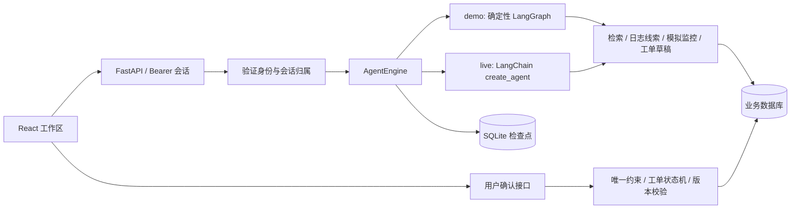

# SupportFlow 架构与源码导读

本项目参考本地 `deer-flow-main` 的 Agent 装配、会话隔离、工具扩展和 Gateway 分层方式，独立实现领域业务。不是 DeerFlow 全量 fork，也不需要先启动其前后端。

## 请求如何完成一轮排查

## 与 DeerFlow 的对应关系

| 本项目 | 参考的 DeerFlow 位置 | 学习重点 |
| --- | --- | --- |
| `backend/supportflow/agent.py` | `backend/packages/harness/deerflow/agents/lead_agent/agent.py` | 通过模型、工具、提示词装配 Agent |
| `configurable.thread_id` | `agents/thread_state.py` 与 runtime | 状态索引与用户授权分开；服务端绑定真实身份 |
| `app.py` 与 `services.py` | Gateway / harness 分层 | HTTP、身份认证、领域事务与 Agent 编排分开 |
| 引用与工具执行元数据 | 检索 Tool artifact / 状态保存 | 回答与证据快照一起保存，重新打开可查看 |
| `deerflow_extension.py` | 公共 `deerflow-extension-api` 与 bookmarks 示例 | 使用公开契约接回 DeerFlow，不导入其内部实现 |

## 关键边界

- `demo` 是真实执行的固定 LangGraph，不含模型调用。检索与工单写入都是真实本地操作；回答整理是确定性规则。
- `live` 使用兼容 OpenAI Chat Completions 的模型与 `create_agent()`，模型决定调用哪些工具。可连接当前学习环境使用的 DeepSeek。
- 业务数据库默认 SQLite，支持配置 SQLAlchemy PostgreSQL URL；Agent 检查点仍使用本地 SQLite。
- 当前版本只支持 **一个 API 进程**。启动时会把中断的 `running` 记录标为失败；不能使用多个 Uvicorn workers，也不宣称具备多实例容错。
- 会话和草稿始终只属于本人。普通提问用户只能访问自己的工单；工程师与管理员可以访问团队工单。团队知识库在本部署内共享，不是多租户知识空间。
- Agent 只有生成草稿的工具，没有确认工单、改状态、执行 shell 或重启服务的工具。
- 工单确认由 `draft_id` 和 `(owner_id, idempotency_key)` 唯一约束去重；键被用于另一份内容时返回 409。
- 工单修改要求提供 `version`，用条件 UPDATE 检查版本。旧版本更新返回 409，前端重新读取最新工单。
- SSE 流输出任务状态、工具完成事件和完整回答，不宣称逐 Token 生成。历史消息另存业务数据库，检查点负责 Agent 延续。
- 模拟监控返回 `synthetic-demo`，不访问真实基础设施。日志规则匹配只给线索，不验证根因。

## 知识检索实现

文档按 Markdown 二级标题切段；长段用 1000 字符窗口、800 字符步长处理。英文按词、中文按双字片段切分，使用 BM25 排序，支持精确产品过滤和版本过滤（匹配指定版本及通用资料）。

这是本地关键词检索，未实现 embedding、向量数据库、重排模型或语义无答案判断。当前无命中判断仅依据是否存在词项匹配。可在 `knowledge.search()` 处替换为 RAGFlow 或独立检索 Provider。

检索结果包含原文、文档 ID、章节、来源、产品、版本和分数；Agent 回复保存本轮检索快照。模型引用是否准确仍需要专门评测，检索命中率不等于回答准确率。

## 数据表

`users` → `access_sessions`；`conversations` → `messages`、`agent_runs`、`ticket_drafts`；`ticket_drafts` → `tickets` → `ticket_comments`、`ticket_events`；`knowledge_documents` 存储共享资料。

初版使用 SQLAlchemy `create_all` 建立新库；它不会迁移已有表结构。后续修改数据结构时应引入 Alembic 迁移，不要直接删除用户数据库。

## 建议的阅读顺序

1. `schemas.py`：看清接口输入。
2. `models.py`：理解用户、会话、草稿和工单之间的关系。
3. `security.py` → `services.py`：身份、归属、幂等和版本检查。
4. `knowledge.py`：观察检索词项、分段和打分。
5. `agent.py`：先读 demo 图，再读真实模型与工具装配。
6. `app.py` 的 chat 接口：观察请求接纳、状态流、结果落库和错误记录。
7. `frontend/src/App.tsx`：跟踪用户点击如何进入对应接口。
