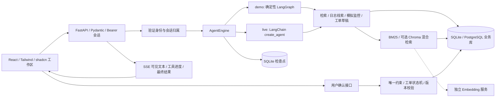

# SupportFlow 架构与源码导读

本项目参考本地 `deer-flow-main` 的 Agent 装配、会话隔离、工具扩展和 Gateway 分层方式，独立实现领域业务。不是 DeerFlow 全量 fork，也不需要先启动其前后端。

## 请求如何完成一轮排查

## 与 DeerFlow 的对应关系

| 本项目 | 参考的 DeerFlow 位置 | 学习重点 |
| --- | --- | --- |
| `backend/supportflow/agent.py` | `backend/packages/harness/deerflow/agents/lead_agent/agent.py` | 通过模型、工具、提示词装配 Agent |
| `model_factory.py` | `models/factory.py` 与 `models/patched_deepseek.py` | 按 Provider 创建模型，回传工具历史中的 DeepSeek 专有字段 |
| `configurable.thread_id` | `agents/thread_state.py` 与 runtime | 状态索引与用户授权分开；服务端绑定真实身份 |
| `app.py` 与 `services.py` | Gateway / harness 分层 | HTTP、身份认证、领域事务与 Agent 编排分开 |
| 引用与工具执行元数据 | 检索 Tool artifact / 状态保存 | 回答与证据快照一起保存，重新打开可查看 |
| `deerflow_extension.py` | 公共 `deerflow-extension-api` 与 bookmarks 示例 | 使用公开契约接回 DeerFlow，不导入其内部实现 |

## 关键边界

- `demo` 是真实执行的固定 LangGraph，不含模型调用。检索与工单写入都是真实本地操作；回答整理是确定性规则。
- `live` 由 `model_factory.create_chat_model()` 选择专用 DeepSeek 或通用 Chat Completions 适配器，再通过 `create_agent()` 决定工具调用。官方 DeepSeek 根据准确主机名自动识别，默认显式禁用思考模式；适配器保留历史 `reasoning_content` 并规范化空工具调用消息。
- 业务数据库本地默认 SQLite，Compose 使用 PostgreSQL 17；SQLAlchemy 管理事务，Alembic 管理版本。Agent 检查点仍使用本地 SQLite，业务库与检查点职责分开。
- 当前版本只支持 **一个 API 进程**。启动时会把中断的 `running` 记录标为失败；不能使用多个 Uvicorn workers，也不宣称具备多实例容错。
- 会话和草稿始终只属于本人。普通提问用户只能访问自己的工单；工程师与管理员可以访问团队工单。团队知识库在本部署内共享，不是多租户知识空间。
- Agent 只有生成草稿的工具，没有确认工单、改状态、执行 shell 或重启服务的工具。
- 工单确认由 `draft_id` 和 `(owner_id, idempotency_key)` 唯一约束去重；键被用于另一份内容时返回 409。
- 工单修改要求提供 `version`，用条件 UPDATE 检查版本。旧版本更新返回 409，前端重新读取最新工单。
- `live` 模式同时消费 LangGraph `messages` / `updates` 流：SSE 输出可见模型文本增量、任务状态、工具完成事件和最终结果；不向前端输出推理内容或工具参数分片。增量携带 `message_key`，前端切换消息时重置临时文本，最终结果覆盖临时展示并落库；断流时明确标记未完成。`demo` 只输出固定工作流的进度和结果。
- 模拟监控返回 `synthetic-demo`，不访问真实基础设施。日志规则匹配只给线索，不验证根因。

## 知识检索实现

文档按 Markdown 二级标题切段；长段用 1000 字符窗口、800 字符步长处理。英文按词、中文按双字片段切分，移除通用停用词，使用 `rank-bm25.BM25Plus` 排序。文档正文与来源元数据共同构成索引缓存键，内容改变后重建；每份文档最多返回两个片段，减少单篇资料占满结果。

BM25Plus 对不存在的词也可能产生基线分数，因此显式要求词项重叠；中文查询通常至少匹配两个有效词项，英文诊断词允许单词命中。带下划线的配置标识完全未知时，关键词模式直接返回空结果。这些规则改善明显误召回，但不能替代语义无答案判定。

`SUPPORTFLOW_RETRIEVAL_MODE` 支持 `bm25`、`vector`、`hybrid`。后两者使用显式配置的 OpenAI 兼容 Embedding 服务与本地持久化 Chroma；模型不由项目自动下载。分批计算变化片段的向量，清理失效片段；向量相似度门槛可配置。混合模式采用 Reciprocal Rank Fusion（RRF，k=60），没有额外重排模型。

SQL 文档始终是来源和过滤范围的依据，支持精确产品过滤与“指定版本 + 通用”过滤。向量查询还校验返回片段是否属于 SQL 允许集合。向量服务故障返回明确错误，不伪装成另一种检索。知识库在部署内共享，目前限制 200 份文档，索引首次同步在请求中完成，尚未引入后台索引队列。

初始语料为 5 份教学资料和 8 份官方来源中文摘要，包含 URL、许可证、获取时间和内容哈希。官方导入脚本校验来源和缓存、按确定 ID 增量更新；整批失败回滚，新文档不能绕过容量限制。内置语料初始化也只在剩余容量内补齐，不覆盖已有文档；容量满时跳过并记录警告，保留已有库正常启动。详情见 [知识来源说明](knowledge-sources.md)。

检索结果包含文本、文档 ID、章节、来源、产品、版本、哈希、检索方法和分数；Agent 回复保存本轮检索快照。模型引用是否准确仍需要专门评测，检索命中率不等于回答准确率。

## 数据表

`users` → `access_sessions`；`conversations` → `messages`、`agent_runs`、`ticket_drafts`；`ticket_drafts` → `tickets` → `ticket_comments`、`ticket_events`；`knowledge_documents` 存储共享资料。

Alembic 的 `0001_baseline` 固定原始业务表结构，`0002_knowledge_sources` 增加可空的来源追踪字段。历史迁移不依赖当前 ORM `create_all`。启动与 CLI 使用同一个迁移入口；无版本旧库先校验表、字段类型、可空性、主外键、唯一约束及活动运行的部分唯一索引，再接管升级。不兼容结构会拒绝处理；部分添加来源字段的旧库可继续升级。迁移不负责 SQLite 与 PostgreSQL 之间的数据复制。

## 前端与部署

Vite 构建 React / TypeScript 应用，Tailwind CSS 通过 Vite 插件集成，shadcn 风格组件基于 Radix / CVA。工作台保留原有绿色主题，公共按钮、卡片、标签、输入框和可访问 Dialog 统一封装；知识页面、文档对话框和资源 Hook 已拆分。生产构建将 UI 与 Markdown 渲染依赖分包。

Compose 启动 Nginx Web、FastAPI API、PostgreSQL 三个服务，通过健康检查约束启动顺序。Nginx 将 `/api` 转发给 API，并关闭 SSE 代理缓冲；只有 Web 的 `127.0.0.1:8010` 对宿主机开放。PostgreSQL 密码从 `.env` 必填项读取，通过 `PGPASSWORD` 交给驱动，避免连接 URL 中特殊字符的编码问题。API 保持单进程，SQLite 检查点与可选 Chroma 位于持久化数据卷。

## 建议的阅读顺序

1. `schemas.py`：看清接口输入。
2. `models.py`：理解用户、会话、草稿和工单之间的关系。
3. `security.py` → `services.py`：身份、归属、幂等和版本检查。
4. `knowledge.py` → `vector_store.py` → `document_import.py`：观察分段、索引、混合排序与来源管理。
5. `agent.py`：先读 demo 图，再读真实模型与工具装配。
6. `app.py` 的 chat 接口：观察请求接纳、状态流、结果落库和错误记录。
7. `migration.py` 与 `migrations/versions/`：理解安全升级和历史结构冻结。
8. `frontend/src/App.tsx` 与 `components/`：跟踪用户点击、SSE 状态与接口调用。
